# Pipeline de transactions bancaires : CI/CD

Projet de la matière **Intégration et Déploiement Continu** (Efrei Paris, M2 Data Engineering & IA).
Auteurs : **Gloria Amini** et **Mohamad Khobaiz**.

Une pipeline Python lit des fichiers CSV de transactions bancaires, les valide, calcule des totaux,
signale les gros montants et enregistre le tout dans PostgreSQL. Chaque modification du code est
**testée automatiquement** (CI) puis **déployée automatiquement** (CD) sur une machine virtuelle.
L'infrastructure de production est aussi décrite en code avec **Terraform** (Azure).

## Ce qui a été réalisé

| Partie | Contenu | Statut |
|---|---|---|
| Niveau 1 | Génération de CSV, chargement, traitements purs, tests, CI GitHub Actions | Fait |
| Niveau 2 | PostgreSQL, stockage S3 (RustFS), anti-doublons, retry, tests d'intégration en CI | Fait |
| Simulation d'échec | Bug volontaire dans une pull request : CI rouge, puis correction : CI verte | Fait |
| Option 1 | Déploiement continu sur une VM (SSH + Docker Compose, secrets GitHub) | Fait et vérifié sur la VM |
| Option 4 | Infrastructure Terraform sur Azure (dossier `infra/`) + workflow de validation | Code fait, validé par la CI (`terraform validate`) |

## Architecture

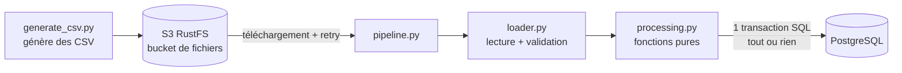

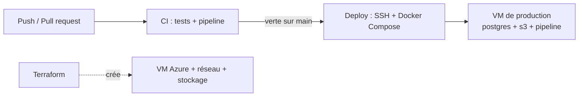

### Structure du dépôt

```
pipeline-data/
  src/          generate_csv.py, loader.py, processing.py, db.py,
                s3_storage.py, retry.py, pipeline.py
  sql/          schema.sql (tables PostgreSQL)
  tests/        34 tests (unitaires, base, S3, retry)
  deploy/       scheduler.sh (relance la pipeline à intervalle régulier)
  docker-compose.yml        environnement local (PostgreSQL + S3)
  docker-compose.prod.yml   environnement de production (+ pipeline)
  Dockerfile
infra/          code Terraform (Azure)
.github/workflows/
  ci.yml        tests + pipeline à chaque push et pull request
  deploy.yml    déploiement automatique après une CI verte sur main
  terraform.yml fmt, init et validate du dossier infra/
```

## Fonctionnement de la pipeline

1. **Génération** : des CSV de transactions sont créés (graine fixe, donc reproductible) et envoyés dans le S3.
2. **Chargement** (`loader.py`) : lecture et validation du format (colonnes, montant positif, date, champs non vides).
3. **Traitement** (`processing.py`, fonctions pures) : total envoyé par IBAN, total envoyé par banque,
   total reçu par IBAN, et flag des transactions dont le montant est **strictement supérieur à 5 000**.
4. **Enregistrement** (`db.py`) : tables `processed_files`, `transactions`, `total_sent_by_iban`,
   `total_sent_by_bank`, `total_received_by_iban`.

### Garanties de fiabilité

- **Tout ou rien** : l'insertion d'un fichier (fichier, transactions, totaux) se fait dans une seule
  transaction SQL. En cas d'erreur, rien n'est écrit.
- **Anti-doublons** : chaque fichier est identifié par le SHA-256 de son contenu (colonne `file_hash`
  unique). Un fichier déjà traité est ignoré, même renommé.
- **Retry** : si la base ou le S3 est indisponible, la pipeline réessaie avec une attente qui double à
  chaque essai (1 s, 2 s, 4 s...), jusqu'au nombre maximal de tentatives.
- **Codes de sortie** : `0` succès, `1` au moins un fichier invalide, `2` pipeline arrêtée (ressource
  indisponible après tous les essais). Les fichiers non traités le sont au lancement suivant.

## Lancer le projet en local

Prérequis : Python 3.12, Docker.

```bash
cd pipeline-data
pip install -r requirements.txt
docker compose up -d --wait          # PostgreSQL + S3 (RustFS)

pytest -v                            # 34 tests
python src/pipeline.py --generate    # génère, envoie au S3, traite, enregistre en base
python src/pipeline.py               # relance : tous les fichiers sont ignorés (déjà traités)

# Démo du retry : 2 pannes simulées à l'insertion, puis succès
python src/pipeline.py --generate --files 4 --seed 7 --simulate-db-failures 2 --retry-delay 0.5

docker compose down -v
```

> RustFS remplace MinIO, qui ne publie plus d'images Docker gratuites. Les deux sont compatibles S3.

## Tests

34 tests avec `pytest` : fonctions pures (dont le cas limite exactement 5 000, non flaggé), génération et
chargement, intégration PostgreSQL (tout ou rien, anti-doublons), intégration S3, et retry avec pannes
simulées. En local, un test d'intégration est ignoré si le service est absent. En CI,
`REQUIRE_SERVICES=1` : un service injoignable **fait échouer** la CI, pour ne jamais valider du code
non testé.

## Intégration continue (`ci.yml`)

Déclenchée à chaque push sur `main` et à chaque pull request :

1. démarre PostgreSQL et le S3 avec `docker compose` ;
2. lance les 34 tests ;
3. exécute la pipeline complète ;
4. la relance et vérifie qu'**aucun fichier n'est retraité** ;
5. montre le retry (2 pannes simulées puis succès).

### Simulation d'échec

Dans la pull request n°2, le seuil de flag a été changé volontairement de 5000 à 500.
La CI est devenue rouge (**4 tests en échec, 30 réussis**), ce qui a bloqué le merge. Le seuil a été
remis à 5000 et la même pull request est repassée au vert.

| Étape | Capture |
|---|---|
| Tests en échec en local | 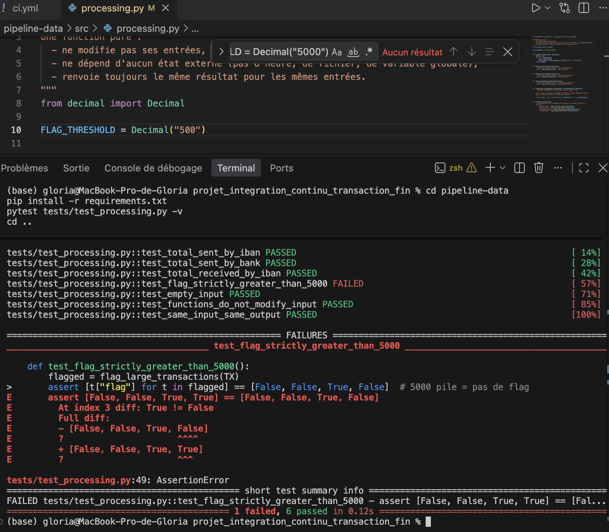 |
| PR n°2 : checks rouges | 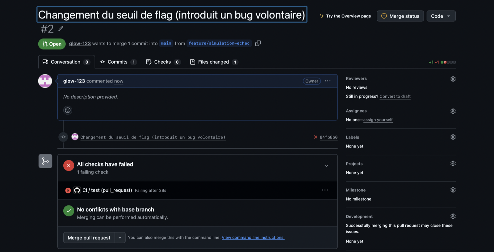 |
| Le changement 5000 vers 500 | 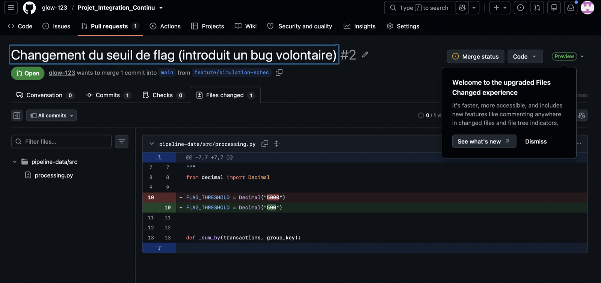 |
| Logs CI : 4 failed, 30 passed | 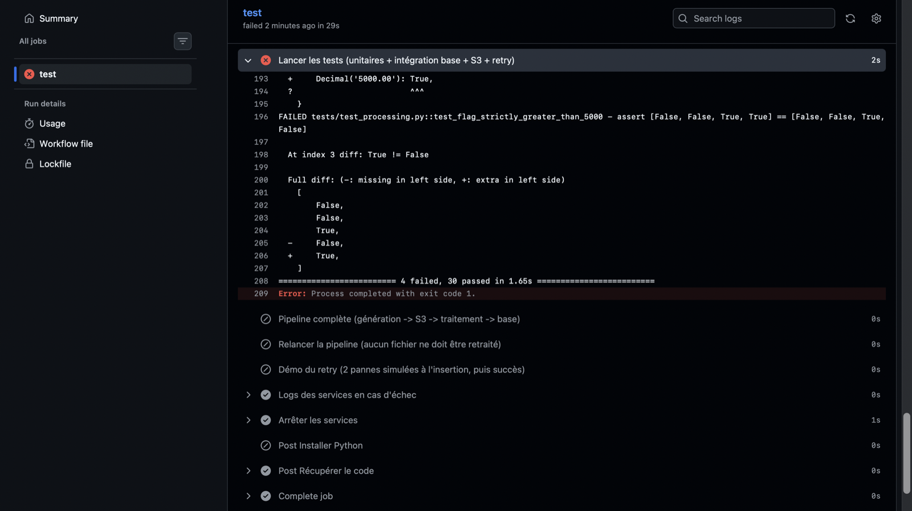 |
| PR n°2 corrigée : verte | 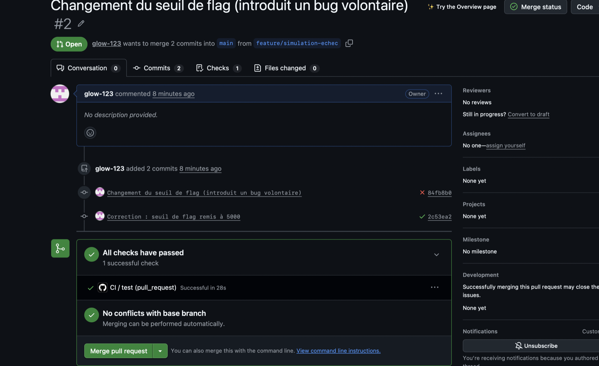 |

CI verte sur `main` :

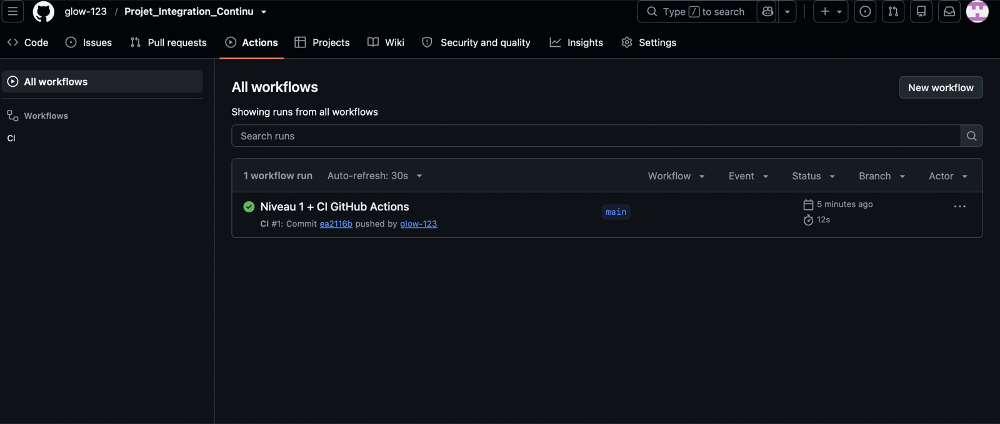

## Déploiement continu (option 1, `deploy.yml`)

Quand la CI est **verte sur `main`**, le workflow *Deploy (CD)* se lance tout seul (`workflow_run`) :

1. récupère le code validé par la CI ;
2. crée le fichier `.env` de production à partir des **secrets GitHub** (`POSTGRES_PASSWORD`,
   `S3_SECRET_KEY`) : aucun mot de passe dans le code ;
3. copie le code sur la VM avec `rsync` via SSH (secrets `VM_HOST`, `VM_USER`, `VM_PASSWORD`) ;
4. lance `docker compose -f docker-compose.prod.yml up -d --build` : PostgreSQL, S3 et la pipeline,
   qui se relance toutes les 60 s (`deploy/scheduler.sh`). Aucun port n'est exposé à l'extérieur.

Vérification sur la VM : 3 conteneurs actifs, 24 transactions en base, et les relances ignorent les
fichiers déjà traités.

```bash
docker compose -p pipeline-prod -f ~/pipeline/docker-compose.prod.yml ps
docker compose -p pipeline-prod -f ~/pipeline/docker-compose.prod.yml exec postgres \
  psql -U pipeline -d pipeline -c "select * from total_sent_by_bank;"
docker compose -p pipeline-prod -f ~/pipeline/docker-compose.prod.yml logs --tail 15 pipeline
```

| Capture |  |
|---|---|
| Deploy (CD) réussi | 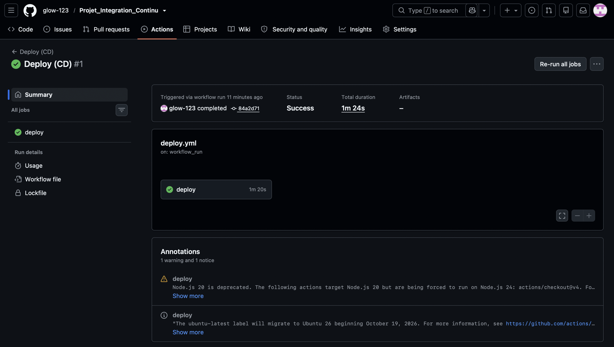 |
| Historique des workflows | 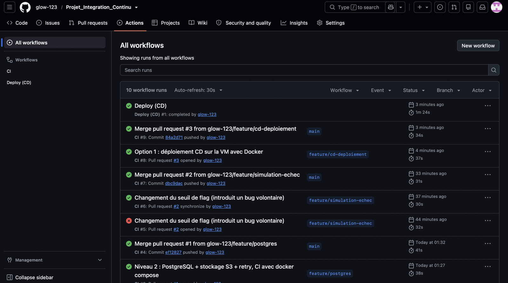 |
| Données en base sur la VM | 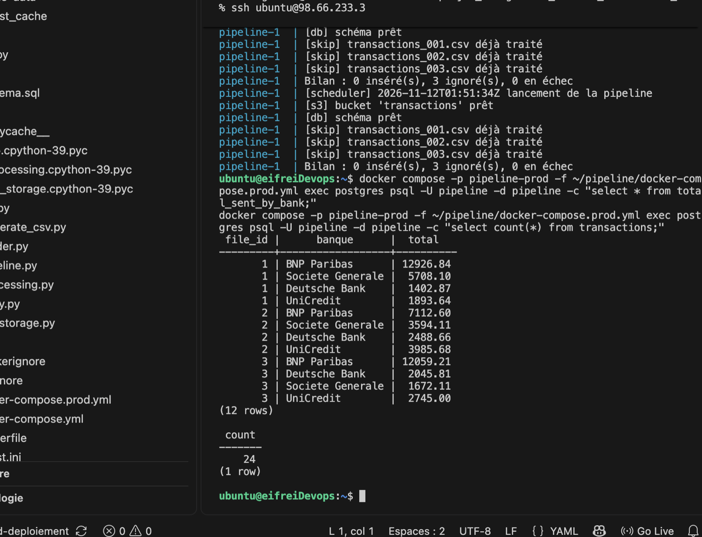 |

## Infrastructure as Code (option 4, `infra/`)

Terraform décrit l'infrastructure de production sur **Azure** :

- un groupe de ressources, un réseau virtuel et un sous-réseau ;
- un pare-feu (NSG) qui n'autorise que le **SSH** (port 22) ;
- une IP publique et une **VM Ubuntu 22.04** (connexion par clé SSH uniquement) ;
- un script `cloud-init` qui installe Docker, clone le dépôt et lance la pipeline au démarrage ;
- un compte de stockage Azure avec un conteneur `transactions`.

Les mots de passe sont des **variables sensibles** ; `terraform.tfvars` et l'état Terraform sont
exclus de git. Le workflow `terraform.yml` lance `fmt -check`, `init` et `validate` à chaque
modification de `infra/`. Les commandes de déploiement (Azure Cloud Shell) sont dans
[`infra/README.md`](infra/README.md).

> Azure n'a pas de S3 natif : la pipeline garde RustFS dans Docker, et le conteneur Blob Azure est un
> stockage complémentaire.

| Capture |  |
|---|---|
| PR Terraform : checks verts | 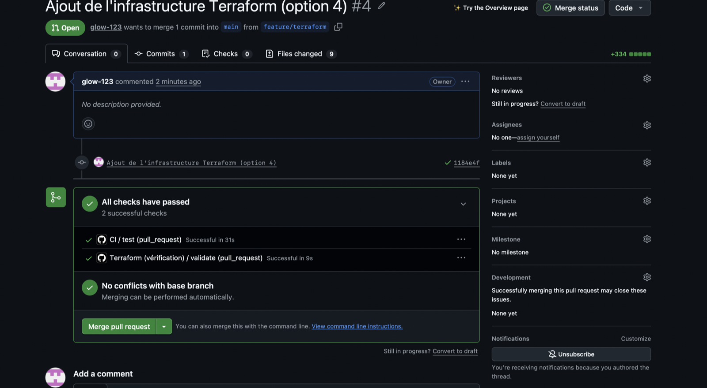 |
| `terraform validate` : succès | 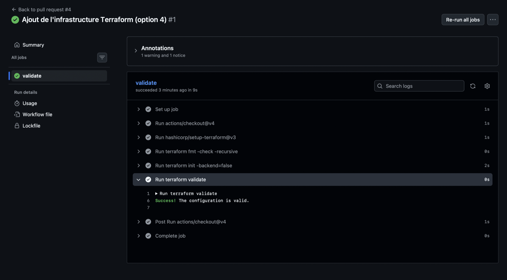 |
| Merge puis Deploy (CD) automatique | 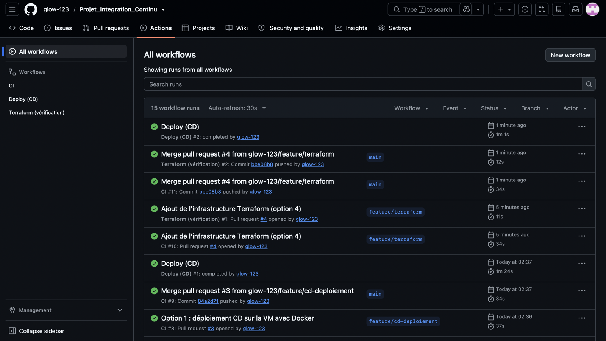 |
